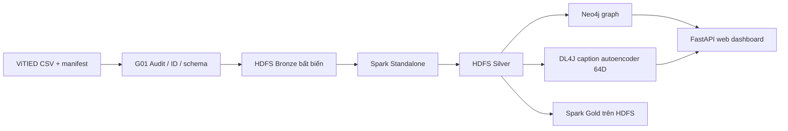

# Phân tích xu hướng chủ đề mạng xã hội — ViTIED

Project xử lý bộ dữ liệu TikTok ViTIED để phân tích thay đổi nội dung trong mẫu KOL/KOC. Kết quả chỉ đại diện cho dữ liệu được thu, không đại diện toàn bộ TikTok. Nguồn CSV bất biến; bài đăng, snapshot quan sát và hashtag là các grain riêng.

## Trạng thái hiện tại

- G01–G04: đạt trên source version ViTIED hiện tại.
- G05: autoencoder DL4J 64 chiều đã train phân tán trên hai worker; chưa có nhãn Topic cấp Post được duyệt nên chưa thể nghiệm thu classifier.
- G06: Gold trên HDFS đã đối soát.
- G07: web dashboard đọc Neo4j trực tiếp; còn chờ kiểm tra trực quan desktop/màn hẹp.
- G08–G09: chưa triển khai; replay Kafka/NiFi là nhánh tùy chọn.

Bảng gate, bằng chứng và việc còn thiếu nằm trong [tiến độ pipeline](reports/progress.md). Kiến trúc và lệnh xem log nằm trong [runbook](docs/architecture-and-logs.md).

## Pipeline



| Chặng | Thành phần | Đầu ra chính |
|---|---|---|
| Intake | Python, manifest SHA-256 | ID canonical, kiểm kê, quarantine pointers |
| Lake | HDFS Bronze/Silver/Gold, Parquet | Bản gốc bất biến, bảng chuẩn hóa, báo cáo theo kỳ |
| Xử lý | Spark Standalone: 1 Master, 2 Worker | Silver, graph export, Gold; job có task witness trên hai worker |
| Đồ thị | Neo4j Community | Post, Observation, Hashtag và quan hệ có bằng chứng |
| Học máy | Java DL4J/ND4J CPU | Autoencoder caption-only embedding 64D, cụm thăm dò để rà soát |
| Giao diện | FastAPI + HTML/CSS/JS | Dashboard đọc Neo4j; không chạy Spark hoặc train khi reload |

Docker Compose chạy cụm một host: 1 NameNode + 3 DataNode (replication 2), Spark Master + 2 Worker + driver, Neo4j. Giữ nguyên các volume hiện có. Không dùng `down -v`, format NameNode, hoặc reset Neo4j khi chạy thường lệ.

## Khởi chạy dashboard

Từ PowerShell tại thư mục gốc:

```powershell
docker compose --profile graph -f infra/compose.yaml -f infra/compose.web.yaml up -d --build neo4j web-dashboard
Invoke-RestMethod http://127.0.0.1:8787/api/health
```

Mở <http://127.0.0.1:8787>. Dashboard dùng Neo4j làm nguồn duy nhất. Cổng chỉ được bind vào loopback. Credential đọc từ Docker secret và không gửi xuống trình duyệt.

## Chạy pipeline batch

Các job cần Docker services tương ứng healthy trước khi chạy. Lệnh Spark dùng client mode từ `spark-driver`.

```powershell
# Kiểm kê/kiểm checksum nguồn
python scripts/audit_vitied.py
python scripts/intake_vitied.py

# HDFS Bronze; kiểm tra sau khi job G03 đã xuất Silver
python scripts/upload_vitied_bronze.py
python scripts/verify_g03_hdfs.py

# Spark Silver (chỉ chạy khi cần tạo release mới)
docker compose -f infra/compose.yaml exec -T spark-driver /opt/spark/bin/spark-submit --master spark://spark-master:7077 --deploy-mode client jobs/spark/03_vitied_silver.py --bronze /trend/vitied/bronze/vitied-20261013-370234d0358b --silver /trend/vitied/silver/vitied-silver-v3/<run_id_moi>

# Kiểm tra dashboard và API
python scripts/verify_g07_web_dashboard.py
```

G04/G05/G06 jobs và tham số release hiện hành được ghi trong [tiến độ pipeline](reports/progress.md) và `--help` của từng script. Mỗi release mới dùng ID/path mới; không ghi đè output đã phát hành.

## Xem log và bằng chứng

```powershell
# Trạng thái/log của cụm
docker compose --profile graph -f infra/compose.yaml -f infra/compose.web.yaml ps -a
docker compose --profile graph -f infra/compose.yaml -f infra/compose.web.yaml logs --tail 100 namenode spark-master spark-worker-1 spark-worker-2 spark-driver neo4j web-dashboard

# Theo dõi console log của lần train đã lưu
Get-Content outputs/quality/g05_train_vitied-g05-captiononly-ae64-live-20261016.console.txt -Wait
```

`outputs/quality/` chứa machine-readable evidence theo gate; `outputs/spark-events/` lưu event log Spark. Báo cáo trạng thái duy nhất là `reports/progress.md`; không cần các bản GD1–GD7 riêng.

## Quy tắc dữ liệu và diễn giải

- `post_id` lấy từ URL TikTok đã kiểm tra; giữ ID dạng chuỗi. `vid_postTime` là thời gian đăng, `vid_scrapeTime` là thời gian quan sát.
- `topic` nguồn là `creator_category` của tác giả, không phải nhãn chủ đề bài. Không dùng trường này làm ground truth.
- Sound ID ký pháp khoa học không được đoán hoặc gộp theo tên. Chỉ tạo Sound edge từ ID xác thực; CSV hiện chưa cung cấp ID đạt điều kiện.
- Không tự tạo Effect/Location khi nguồn không có trường tương ứng.
- Split G05 theo author và caption trùng trước khi fit IDF; snapshot cùng Post ở cùng split. Caption lấy từ Observation sớm nhất; feature caption-only không dùng hashtag.
- Cụm DL4J là kết quả khám phá, chưa phải Topic được duyệt. Không ghi prediction lên nhãn manual.
- Dashboard trend là thống kê mẫu creator. Dữ liệu nguồn kết thúc 02/07/2025; các phép chiếu sau mốc đó là hồi cứu, không phải dự báo TikTok hiện tại.

## Cấu trúc repo

- `jobs/spark/`, `scripts/`, `graph/`, `apps/`: mã pipeline và giao diện.
- `infra/`: Docker Compose và cấu hình HDFS/Spark.
- `data/`: manifest, quarantine pointer và phiếu rà soát; CSV raw được giữ ngoài Git.
- `outputs/quality/`: kết quả kiểm chứng; `outputs/g04`, `outputs/g05`, `outputs/g07`: release/artifact.
- `reports/progress.md`: tiến độ và gate duy nhất.
