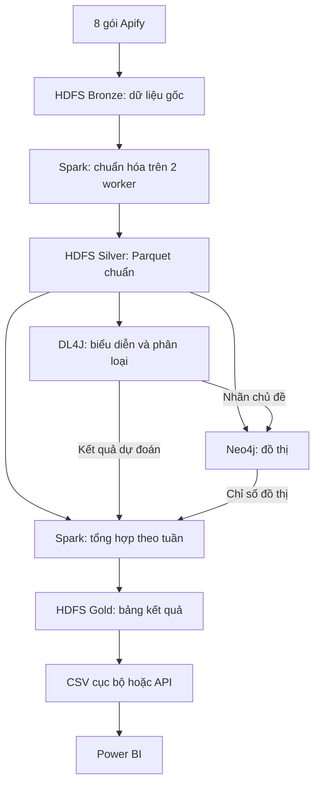
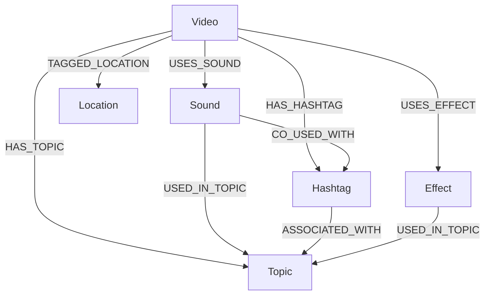

# Phân tích xu hướng chủ đề trên mạng xã hội

Project môn Nhập môn Big Data, sử dụng dữ liệu video TikTok để phân tích xu hướng chủ đề và quan hệ với âm thanh, hashtag, hiệu ứng, địa điểm theo thời gian. Video là trung tâm đồ thị; thông tin KOL là metadata nguồn. Stack chính: HDFS cho lưu trữ phân tán, Apache Spark Standalone cho xử lý song song, Deeplearning4j (DL4J) cho học máy, Neo4j cho đồ thị và Power BI cho báo cáo. NiFi/Kafka, GDS và API là phần mở rộng, không chặn bản batch.

Coding agent bắt đầu từ [AGENTS.md](AGENTS.md).

### Trạng thái thiết lập trong repository (11/10/2026)

G01 đã có script kiểm kê dữ liệu thật tại `scripts/intake.py`. Tám export gốc trong `crawled_data/` được sao chép nguyên byte sang `data/raw/apify/` khi chạy lần đầu; lần chạy sau kiểm tra SHA-256 và từ chối ghi đè nếu bản raw khác nguồn. Chạy từ root project:

```powershell
python scripts/intake.py
python -m unittest discover -s tests -v
```

Đầu ra: `data/raw/manifests/apify_g01.json`, `outputs/quality/g01_inventory.json`, `outputs/quality/g01_inventory.md` và pointer lỗi ở `data/quarantine/g01_pointers.json`. Mapping các trường đã xác nhận từ 8 PACK nằm ở `config/apify_mapping.json`; trạng thái G01–G09 ở `reports/progress.md`. Hiện chưa có `data/reference/kol.csv` để đối soát đầy đủ 578 username đầu vào, nên G01 còn `in_progress`. Các giai đoạn G02–G09 chưa triển khai. Docker CLI có sẵn nhưng daemon chưa hoạt động tại lần kiểm tra này; Java hệ thống là 25, chưa kiểm chứng với DL4J/Spark. Không coi bản sao raw trên Windows là HDFS Bronze.

## 1. Phạm vi và trạng thái

- Người thực hiện đã thu dữ liệu bằng TikTok Profile Scraper của Clockworks trên Apify, chia thành 8 gói.
- Danh sách crawl có 578 username duy nhất, mục tiêu tối đa 10 video/KOL. Kiểm kê trực tiếp 8 file PACK1–PACK8 được cung cấp ngày 11/10/2026 cho thấy 4.725 record: 4.673 video có ID duy nhất, 36 record lỗi và 16 record chỉ có `authorMeta/input/note`. Không trộn bản sao PACK1 vào 8 file đầu vào. Các con số này là baseline của bộ file đã đọc, không phải count hardcode cho các lần chạy sau.
- Danh sách tham khảo ban đầu có 24 danh mục. Một KOL có thể thuộc nhiều danh mục; một video có thể thuộc nhiều chủ đề.
- Dữ liệu hiện tại là mẫu video của các KOL được chọn, không đại diện mặc định cho toàn bộ TikTok.
- Không sử dụng GNN. DL4J phụ trách biểu diễn văn bản và phân loại nhiều nhãn.

**Hai tài liệu này mô tả thiết kế, chưa xác nhận pipeline đã triển khai.** Các đường dẫn mã nguồn, cấu hình, manifest và lệnh chạy cần được triển khai. Đã đọc và kiểm kê trực tiếp 8 JSON trong phiên thiết kế; chưa chạy pipeline Spark, nạp Neo4j, huấn luyện mô hình hoặc dựng dashboard. Cập nhật này chốt schema đồ thị tại mục 7 và các đầu ra liên quan.

## 2. Kết quả cần đạt

1. Một bộ dữ liệu chuẩn hóa có nguồn gốc, timestamp và báo cáo chất lượng.
2. Một đồ thị thống nhất Video–Sound–Hashtag–Effect–Location–Topic trong Neo4j: 5 quan hệ gốc và 6 quan hệ tổng hợp có bằng chứng/cửa sổ thời gian. Xem mục 7.
3. Mô hình DL4J phân loại video nhiều chủ đề, có đánh giá trên tập giữ lại.
4. Thống kê chủ đề và hashtag theo tuần trong phạm vi mẫu thu thập.
5. Dashboard Power BI hiển thị phân bố nội dung, các mối liên hệ và thay đổi theo thời gian đăng.
6. Luồng phát lại qua NiFi/Kafka ở giai đoạn mở rộng, được ghi rõ là dữ liệu lịch sử.
7. Cụm HDFS có nhiều DataNode và bằng chứng vị trí/replica của block.
8. Spark job chạy trên hai worker, có bằng chứng executor/task thực tế và phép đo với cấu hình một worker để đối chiếu.

## 3. Kiến trúc



Pipeline batch được triển khai trước. Giai đoạn streaming đưa record từ file qua NiFi → Kafka → Spark Structured Streaming, rồi dùng lại logic chuẩn hóa và các đầu ra của pipeline batch.

### 3.1. Các tầng của hệ thống và bằng chứng cần có

| Tầng | Công cụ được chọn | Việc làm với dataset này | Bằng chứng hoàn thành |
|---|---|---|---|
| Thu thập | Apify, đã thực hiện | Xuất video và metadata theo KOL | File nguồn, thời gian/run, báo cáo số lượng thực |
| Nhập và quản lý nguồn | Job intake; NiFi khi mở rộng | Kiểm kê 8 file, giữ manifest, chuyển bản sao vào kho | Checksum, số record, lỗi và provenance |
| Truyền sự kiện | Kafka khi làm replay/streaming | Chuyển record giữa producer và consumer | Topic, partition, offset và thử restart |
| Lưu trữ phân tán | HDFS | Lưu Bronze/Silver/Gold và checkpoint | DataNode sống, vị trí block, replica, đọc lại |
| Quản lý tài nguyên xử lý | Spark Standalone Master/Workers | Cấp executor/CPU/RAM cho job | Worker đăng ký và tài nguyên đã cấu hình |
| Xử lý song song | Spark SQL/DataFrame | Chuẩn hóa, join, groupBy, tạo cặp hashtag | Task/partition, shuffle, executor metrics |
| Truy vấn bảng | Spark SQL | Tổng hợp theo tuần và truy vấn các bảng Parquet | Query, schema, grain và đối soát đầu ra |
| Học máy | DL4J/ND4J | Vector văn bản và phân loại nhiều nhãn | Model, split, baseline và metrics |
| Phân tích quan hệ | Neo4j, GDS khi cần | Đồ thị nội dung và projection hashtag | Node/cạnh, truy vấn và chỉ số đồ thị |
| Phục vụ kết quả | CSV; Spring Boot tùy chọn | Cung cấp bảng đã tính cho báo cáo | Hợp đồng cột/API, snapshot dữ liệu |
| Trực quan hóa | Power BI | Chủ đề, hashtag, KOL và thay đổi theo tuần | Dashboard khớp số liệu nguồn |
| Vận hành | Script, manifest, log, các UI dịch vụ | Điều phối thứ tự, phát hiện lỗi, chạy lại | Run ID, exit status, kiểm tra chất lượng |

Kafka không thay thế HDFS. Parquet là định dạng file, không tự tạo hệ lưu trữ phân tán. Neo4j là lớp phục vụ quan hệ; không thay thế kho raw/Parquet. Spark SQL đáp ứng tầng truy vấn ban đầu; Hive/Drill/Knox chỉ thêm khi có nhu cầu hoặc yêu cầu môn học cụ thể.

### 3.2. Lưu trữ phân tán bằng HDFS

Cấu hình mục tiêu cho demo: **1 NameNode + 3 DataNode**, `dfs.replication=2`. Mỗi DataNode có persistent volume riêng; NameNode có volume metadata riêng. NameNode quản lý namespace và vị trí block; dữ liệu được client đọc/ghi trực tiếp qua DataNode. Số replica không có nghĩa mọi file được chép đầy đủ lên mọi node.

Một file có thể gồm một hoặc nhiều block, tùy kích thước và cấu hình. Với 8 file metadata nhỏ, mỗi file có thể chỉ có một block; không ép chia theo “mỗi KOL một block”. HDFS block và Spark partition là hai đơn vị khác nhau.

| Vùng HDFS | Nội dung | Quy tắc |
|---|---|---|
| `/bigdata-topic/bronze/apify/<collection_id>/` | Bản sao nguyên gốc các export | Không ghi đè; manifest/checksum giữ nguồn |
| `/bigdata-topic/silver/videos/` | Video duy nhất đã chuẩn hóa | Parquet, schema có phiên bản |
| `/bigdata-topic/silver/observations/` | Snapshot tương tác | Giữ lịch sử theo lần thu thật |
| `/bigdata-topic/silver/graph/` | Bảng node/cạnh | Tạo từ dữ liệu chuẩn và nhãn |
| `/bigdata-topic/gold/topic_weekly/` | Thống kê phục vụ báo cáo | Grain Topic × tuần |
| `/bigdata-topic/gold/hashtag_pairs_weekly/` | Mạng đồng xuất hiện | Cặp Hashtag × tuần |
| `/bigdata-topic/checkpoints/<query_id>/` | Trạng thái Structured Streaming | Tách theo query; không phải dữ liệu huấn luyện |
| `/bigdata-topic/manifests/` | Manifest và metadata lần chạy | Đối soát, phiên bản và lineage |

Endpoint thiết kế: `hdfs://namenode:8020`; đây là giá trị phải cấu hình, không giả định mọi image dùng cổng này. Trong chế độ distributed, HDFS là nguồn đầu vào/đầu ra chuẩn của Spark. Các thư mục `data/` trên Windows giữ bản nguồn, fixture và bản xuất có kiểm soát, không phải một kho phân tán thứ hai.

Kiểm chứng sau khi cấu hình và dịch vụ tồn tại: `hdfs dfsadmin -report` kiểm tra các DataNode; `hdfs fsck /bigdata-topic/bronze -files -blocks -locations` kiểm tra block/replica; đọc lại dữ liệu để đối soát. Demo dừng một DataNode chỉ trên môi trường thử nghiệm, sau khi xác nhận replica đầy đủ, rồi kiểm tra đọc dữ liệu và quá trình phục hồi. Không hứa đọc liên tục hoặc phục hồi tức thì; NameNode đơn vẫn là điểm lỗi đơn. Replication không thay thế backup độc lập.

### 3.3. Xử lý song song bằng Spark Standalone

Cấu hình demo đề xuất: **1 Master + 2 Worker**, mỗi worker giới hạn **2 core và 2 GiB bộ nhớ cho Spark**, driver khoảng **1 GiB heap**. Đây là điểm xuất phát để đo, không phải cấu hình tối ưu đã được kiểm tra; cần thêm bộ nhớ cho hệ điều hành, JVM overhead và các dịch vụ khác.

| Thành phần | Trách nhiệm |
|---|---|
| Driver | Tạo execution plan, chia stage và lập lịch task |
| Standalone Master | Quản lý đăng ký worker và cấp tài nguyên executor |
| Worker | Quản lý các executor trên node |
| Executor | Thực thi task, cache và shuffle dữ liệu |
| Partition | Một phần dữ liệu logic được task của một stage xử lý |
| Shuffle | Phân phối lại dữ liệu khi cần gom theo khóa/join |

Master không trực tiếp xử lý record và không thay driver lập lịch task. Với hai executor có tổng 4 task slot theo core, một stage 8 partition có thể chạy tối đa khoảng 4 task đồng thời khi đủ tài nguyên, rồi chạy phần còn lại; không mặc định mỗi worker nhận chính xác nửa dataset.

Ví dụ job hashtag theo tuần: đọc Silver → tách mảng hashtag → chuẩn hóa/bỏ trùng trong Video → tính tuần → groupBy `(week, hashtag)` → đếm Video duy nhất → ghi Gold. Các phép biến đổi chạy trên partition; groupBy có thể tạo shuffle để gom cùng khóa, rồi tổng hợp kết quả. Thuật toán được chia task, không phải chạy toàn bộ job hai lần trên hai worker.

Chạy bằng `spark-submit --master spark://spark-master:7077 --deploy-mode client` từ container driver có kết nối tới HDFS và workers. Cần triển khai image/entry point trước khi chạy. Với PySpark trên Standalone, dùng client mode; không giả định Python application dùng Standalone cluster deploy mode được hỗ trợ. Không hardcode `.master("local[*]")` trong job cần kiểm chứng nhiều worker.

JSON dạng mảng với `multiLine=true` có thể hạn chế chia nhỏ đầu vào theo file. Sau intake, chuẩn hóa sang JSONL hoặc Parquet; đo partition/task thực tế, dùng `repartition` khi có lý do. Thử 4–8 partition xử lý ban đầu và cấu hình shuffle phù hợp; AQE có thể hợp nhất partition nhỏ. Không tạo một file Parquet/Video hoặc ép mọi kết quả qua `coalesce(1)`. Phân vùng thư mục chỉ theo cột có lợi cho truy vấn và dung lượng thực tế; không tạo quá nhiều thư mục tuần/chủ đề nhỏ với dataset hiện tại.

### 3.4. Song song trên một máy và phân tán nhiều máy

| Chế độ | Cách chạy | Có thể chứng minh | Giới hạn |
|---|---|---|---|
| `local` | Spark local, file cục bộ | Logic đúng; nhiều thread trên một máy | Không chứng minh xử lý nhiều worker hoặc storage phân tán |
| `distributed-demo` | HDFS 3 DataNode + Spark 2 Worker trong Docker trên cùng Windows host | Cơ chế giao tiếp, replication giữa process, phân phối task giữa executor | Chung CPU, RAM, đĩa và điểm lỗi máy chủ |
| `multi-host` | Các DataNode/Worker trên máy vật lý/VM độc lập | Phân tán tài nguyên và thử lỗi host trong topology đã cấu hình | Cần mạng, hostname, storage và quản trị nhiều máy |

Trong báo cáo ghi đúng chế độ đã chạy. Bản mục tiêu hiện tại là `distributed-demo`; nâng lên `multi-host` nếu yêu cầu giảng viên là phân tán trên nhiều máy thật. Chạy nhiều container trên một host vẫn kiểm chứng cơ chế phần mềm nhưng không chứng minh chịu mất host/đĩa hoặc scale-out vật lý.

### 3.5. Học máy và đồ thị được triển khai tới mức nào?

DL4J trước mắt train trên một JVM bằng backend CPU; ND4J có thể dùng nhiều thread tùy backend/cấu hình. Điều này không phải distributed training trên hai worker Spark. Spark chuẩn bị dữ liệu bằng cụm; DL4J nhận tập đã chuẩn bị qua một bước export có manifest. Inference đầu tiên cũng chạy ở job Java riêng, sau đó import prediction về Silver/Gold. Không tự triển khai DL4J-Spark training vì quy mô hiện tại và yêu cầu không cần nó.

Neo4j Community dùng một instance. GDS nếu cài thực thi theo khả năng phiên bản/licence của instance đó, không tự biến Neo4j thành cụm lưu trữ phân tán. Lớp phân tán của thiết kế nằm ở HDFS và Spark; không bắt mọi công cụ phải có cùng kiểu phân tán.

### 3.6. Cấu hình, phục vụ và điều phối

Các file cần triển khai thêm:

| Đường dẫn dự kiến | Nội dung |
|---|---|
| `infra/compose.yaml` | HDFS, Master/Workers, driver, Neo4j; NiFi/Kafka theo profile |
| `infra/hadoop/core-site.xml` | `fs.defaultFS` và endpoint HDFS |
| `infra/hadoop/hdfs-site.xml` | Replication, data directories và cấu hình HDFS |
| `infra/spark/spark-defaults.conf` | Core, memory, shuffle, event log theo môi trường |
| `config/pipeline.yaml` | `storage_backend`, đường dẫn Bronze/Silver/Gold, timezone, schema |
| `scripts/upload_raw.cmd` | Nạp bản nguồn vào Bronze, giữ manifest và không ghi đè |
| `scripts/run_batch.cmd` | Submit job theo thứ tự, dừng nếu bước trước lỗi |
| `scripts/export_powerbi.cmd` | Xuất Gold thành CSV cục bộ hoàn chỉnh |
| `scripts/verify_cluster.cmd` | Kiểm tra HDFS và thu bằng chứng Spark |

Giữ log/event log cùng run ID; Spark UI/History Server giúp xem job, stage, executor và shuffle khi cấu hình. HDFS UI/report giúp xem node và block. Kafka cần theo dõi lag khi streaming; Neo4j cần kiểm tra transaction lỗi và count đối soát. Không cần thêm một công cụ orchestration mới ở giai đoạn đầu: wrapper có exit code, config và manifest đáp ứng luồng batch này.

Power BI đọc bản export Gold ở Windows hoặc API phục vụ Gold đã vật chất hóa. Project Java trên Windows không tự hiểu hostname HDFS nội bộ Docker: dùng bước export đặc trưng cho DL4J; nếu muốn Java đọc HDFS trực tiếp, phải triển khai Hadoop client và kết nối mạng tương ứng.

### 3.7. Kiểm chứng hiệu năng và tài nguyên

1. Giữ nguyên dataset, thuật toán và cấu hình storage; ghi CPU/RAM/phiên bản.
2. So sánh cùng job trên 1 worker và 2 worker. Nếu giữ 2 core/worker thì đây là phép đo thêm tài nguyên; nếu so sánh topology với cùng tổng core, ghi rõ và cấu hình tương ứng.
3. Lưu wall time, số task, executor thật, shuffle bytes, CPU/RAM và row count đầu ra. Kiểm soát cache/cold-warm; lặp phép đo có chủ đích và báo biến thiên.
4. Kiểm tra kết quả giữa hai cấu hình tương đương, không chỉ thời gian.
5. Với bộ metadata vài nghìn video (baseline hiện tại 4.673 Video), overhead có thể khiến cụm chậm hơn local. Đây vẫn là kết quả hợp lệ; không cam kết speedup vì dùng Spark.
6. Nếu tạo dữ liệu mở rộng để đo tải, lưu riêng và ghi rõ synthetic. Không cộng bản sao/replay vào số video độc lập hoặc dùng chúng tạo bằng chứng ML mới.

Tài nguyên demo phải dựa trên máy thực tế. Dự toán thực hành: máy 16 GiB RAM chạy theo từng nhóm dịch vụ; 24–32 GiB thuận tiện hơn khi chạy nhiều dịch vụ đồng thời. Đây là ước lượng, không phải yêu cầu nhà cung cấp hoặc kết quả benchmark. Cấp Docker đủ CPU/RAM/đĩa; worker memory không bao gồm toàn bộ overhead của container.

## 4. Công cụ và môi trường

| Công cụ | Vai trò | Cách triển khai dự kiến |
|---|---|---|
| Docker Desktop | Chạy các dịch vụ và quản lý volume | Windows với backend phù hợp |
| HDFS | Lưu trữ phân tán Bronze/Silver/Gold | 1 NameNode + 3 DataNode, volume riêng, replication 2 |
| Spark / PySpark | Chuẩn hóa song song, thống kê, tạo bảng node/cạnh | 1 Master + 2 Worker + driver container; viết mã bằng VS Code |
| Java JDK và Maven | Biên dịch, chạy project DL4J | IntelliJ trên Windows; Maven Wrapper khi triển khai |
| DL4J + ND4J | Word2Vec và FNN/MLP nhiều nhãn | CPU trước, project Maven riêng |
| Neo4j Community | Lưu và truy vấn đồ thị | Container có persistent volume |
| Neo4j Graph Data Science | PageRank, phát hiện cộng đồng | Plugin GDS tương thích với Neo4j, thêm khi cần |
| Power BI Desktop | Dashboard | Chạy trên Windows |
| NiFi và Kafka | Nhập, định tuyến và phát lại dữ liệu | Container, triển khai sau |
| Spring Boot | Phục vụ bảng kết quả qua REST API | Tùy chọn, sau khi CSV hoạt động đúng |

Điểm xuất phát tham khảo: Spark 4.0.2 với Java 17 và Python 3.11; các artifact DL4J/ND4J cùng phiên bản 1.0.0-M2.1. Trước khi chốt dependency, kiểm tra phiên bản thực tế, khởi động ND4J và chạy smoke test. Ghi phiên bản đã kiểm tra trong dependency/lock file và tài liệu môi trường. NiFi và các dịch vụ container sử dụng runtime riêng trong image; không suy ra rằng mọi dịch vụ dùng chung JDK của máy chủ.

Các artifact Maven cần cho phương án DL4J này: `org.deeplearning4j:deeplearning4j-core`, `org.deeplearning4j:deeplearning4j-nlp` và `org.nd4j:nd4j-native-platform`. Không trộn phiên bản của các artifact này.

Không cần cài toàn bộ 23 công nghệ trong tài liệu học tập. HDFS thuộc thiết kế chính sau yêu cầu làm rõ lưu trữ phân tán. Local file/Parquet chỉ là chế độ kiểm tra logic ban đầu hoặc vùng staging/export; khi nghiệm thu phần phân tán, job phải đọc/ghi HDFS và chạy trên hai worker thật của topology đã chọn.

## 5. Cấu trúc thư mục

Đặt cả project trong một thư mục, ví dụ `C:\bigdata-topic`. Đặt `README.md` và `AGENTS.md` tại gốc project.

| Đường dẫn tương đối | Nội dung và trách nhiệm |
|---|---|
| `README.md` | Giới thiệu, cấu trúc, cách triển khai và sử dụng |
| `AGENTS.md` | Quy tắc cho coding agent làm việc trong repository |
| `data/raw/apify/` | 8 file Apify nguyên gốc, không chỉnh sửa |
| `data/raw/manifests/` | Metadata nguồn: tên file, checksum, mã lần thu, thời gian thu nếu biết |
| `data/reference/` | `kol.csv`, định nghĩa chủ đề, bảng ánh xạ và quy tắc chuẩn hóa |
| `data/clean/` | Parquet chuẩn hóa: videos, authors, observations, hashtags, music |
| `data/clean/graph/` | Các bảng node/cạnh phục vụ nạp Neo4j |
| `data/labels/` | Nhãn video được kiểm tra, nguồn nhãn và trạng thái rà soát |
| `data/features/` | Split manifest và dữ liệu đặc trưng phục vụ DL4J |
| `data/predictions/` | Nhãn dự đoán, điểm dự đoán, phiên bản mô hình |
| `data/quarantine/` | Record lỗi hoặc xung đột cần xem xét |
| `jobs/spark/` | Chương trình PySpark theo từng bước |
| `apps/dl4j/` | Project Java Maven |
| `apps/api/` | Spring Boot phục vụ kết quả, tùy chọn |
| `graph/` | Constraints, truy vấn Cypher, mã nạp và phân tích đồ thị |
| `infra/` | Docker Compose, cấu hình dịch vụ và NiFi flow |
| `infra/hadoop/` | Cấu hình NameNode/DataNode, HDFS client |
| `infra/spark/` | Cấu hình Master/Workers, driver và event log |
| `config/` | Cấu hình pipeline không chứa bí mật |
| `scripts/` | Các lệnh thao tác lặp lại trên Windows |
| `models/` | Mô hình, tokenizer, vector từ, thứ tự nhãn và ngưỡng dự đoán |
| `outputs/powerbi/` | CSV cuối cùng cho Power BI |
| `outputs/quality/` | Báo cáo chất lượng và đối soát từng lần chạy |
| `reports/` | Dashboard `.pbix`, kết quả đánh giá và tài liệu báo cáo |
| `tests/` | Fixture tổng hợp và kiểm tra hành vi quan trọng |

Không commit dữ liệu raw đầy đủ, bí mật, checkpoint, volume database hoặc model lớn vào Git theo mặc định. Commit mã nguồn, tài liệu, cấu hình mẫu và fixture nhỏ có thể chia sẻ.

### Windows và Docker dùng chung dữ liệu

Mount thư mục gốc project vào `/workspace` trong container Spark:

| Windows | Container Spark |
|---|---|
| `C:\bigdata-topic\data\raw\apify` | `/workspace/data/raw/apify` |
| `C:\bigdata-topic\data\clean` | `/workspace/data/clean` |
| `C:\bigdata-topic\jobs\spark` | `/workspace/jobs/spark` |

Compose nằm tại `infra/compose.yaml`, nên mount root theo đường dẫn được resolve từ vị trí Compose, không mặc định `.` là root project. Neo4j lưu database trong volume riêng; `graph/` chỉ chứa mã và câu lệnh.

Mount trên dùng cho source, intake và export. HDFS không được hiện thực bằng cách cho 3 DataNode cùng mount một thư mục block: mỗi node phải có volume độc lập, Spark truy cập qua URI HDFS. Driver và các executor đều cần HDFS config và truy cập được địa chỉ DataNode trả về.

## 6. Hợp đồng dữ liệu

Ưu tiên đầu vào JSON/JSONL để giữ các cấu trúc lồng nhau. Nếu đang có CSV, giữ file đó và viết adapter phù hợp. Spark đọc cả 8 file; không nối thủ công các mảng JSON.

| Trường chuẩn | Kiểu | Ý nghĩa |
|---|---|---|
| `video_id` | string | ID video chính xác, bắt buộc để tạo Video |
| `author_id`, `author_username` | string | Định danh người đăng; ưu tiên ID ổn định |
| `author_followers`, `author_hearts` | long nullable | Số liệu tác giả tại lần quan sát |
| `text` | string nullable | Caption/description |
| `hashtags`, `mentions` | array of string nullable | Thẻ và tài khoản được nhắc đến |
| `music_id`, `music_title` | string nullable | Định danh và tên âm thanh |
| `music_author`, `music_album`, `music_play_url` | string nullable | Metadata từ musicMeta; URL không phải file âm thanh đã tải |
| `is_original_sound` | boolean nullable | Cờ âm thanh gốc theo nguồn, không kết luận bản quyền |
| `play_count`, `digg_count` | long nullable | Lượt xem, lượt thích |
| `share_count`, `comment_count` | long nullable | Lượt chia sẻ, bình luận |
| `collect_count`, `repost_count` | long nullable | Lượt lưu và đăng lại, giữ riêng theo nguồn |
| `effects` | array of struct nullable | effectId dạng chuỗi và tên, từ effectStickers[].ID/name |
| `location` | struct nullable | locationId, tên, địa chỉ, city/cityCode/countryCode từ locationMeta |
| `text_language`, `subtitle_links` | string / array of struct nullable | Ngôn ngữ và tham chiếu phụ đề; chưa mặc định có transcript |
| `is_ad`, `is_sponsored`, `has_shop_product`, `is_slideshow`, `is_pinned`, `is_story` | boolean nullable | Cờ nội dung/định dạng theo nguồn |
| `duration` | double nullable | Thời lượng theo giây |
| `create_time` | timestamp | Thời gian đăng |
| `observed_at` | timestamp nullable | Thời gian quan sát số liệu |
| `is_duet`, `is_stitch` | boolean nullable | Trạng thái có bằng chứng từ nguồn |
| `duet_source_video_id`, `stitch_source_video_id` | string nullable | Video nguồn nếu lấy được |
| `source_file`, `collection_id`, `schema_version` | string | Nguồn gốc và phiên bản chuẩn hóa |

Tên trường Apify phải được xác nhận từ file thực tế. Mapping được quản lý trong config, không giả định mọi bản export cùng schema.

### Quy tắc dữ liệu

- Giữ ID dạng chuỗi; không chuyển qua `float` hoặc Excel để chuẩn hóa ID.
- Thiếu dữ liệu giữ `null`; phân biệt với số 0, `false` và mảng rỗng đã được xác nhận.
- Loại bản ghi lặp chính xác, nhưng giữ nhiều lần quan sát của cùng video.
- `collection_id` nhận diện lần thu thật; 8 file không nhất thiết tương ứng 8 lần quan sát độc lập.
- Nếu timestamp thu chỉ lấy từ khoảng thời gian run, lưu phương pháp/độ chính xác. Thời gian nhập pipeline không tự động là thời gian quan sát nguồn.
- Không ghi đè raw. Record không hợp lệ được ghi vào quarantine kèm lý do; không loại video chỉ vì thiếu hashtag hoặc nhạc.
- Thời gian lưu chuẩn theo UTC; tổng hợp lịch theo `Asia/Ho_Chi_Minh`.

## 7. Thiết kế đồ thị

### 7.1. Phạm vi và bằng chứng dữ liệu

Đồ thị lấy **Video làm trung tâm**, dùng chung các node thực thể giữa cả 8 gói. Không tạo node âm thanh/hashtag riêng cho từng video hoặc từng PACK. Không tự thêm Author, Category, Music, Observation vào schema chính; tên label âm thanh đã chốt là `Sound`. Thông tin tác giả và mentions giữ trong Silver/metadata; lịch sử lần quan sát giữ ở bảng nguồn, không bắt buộc thành node. Không suy diễn duet/stitch hoặc đường lan truyền từ các trường không có bằng chứng.

Kết quả kiểm kê JSON và tính thành phần liên thông trong phiên thiết kế ngày 11/10/2026, chưa phải bằng chứng pipeline Spark/Neo4j đã được triển khai:

| Chỉ tiêu | Baseline của 8 file |
|---|---:|
| Video có ID duy nhất; duplicate video ID | 4.673; 0 |
| Sound / Hashtag chuẩn hóa / Effect / Location | 4.326 / 4.360 / 288 / 210 |
| Cạnh USES_SOUND / HAS_HASHTAG / USES_EFFECT / TAGGED_LOCATION | 4.673 / 14.517 / 3.246 / 392 |
| Thành phần liên thông có Video, bỏ qua hướng cạnh gốc | 693 |
| Video trong thành phần lớn nhất | 3.664, tương đương 78,41% |
| Thành phần chỉ có một Video, dù Video vẫn có node thuộc tính nối tới | 629 |
| Video thiếu cả caption và hashtag | 145 |
| Cặp hashtag xuất hiện chung trong ít nhất 3 Video | 3.053 |

Mức liên thông trên chỉ dùng Sound, Hashtag, Effect, Location; chưa có Topic hoặc SIMILAR_CONTENT. Tính lại khi đổi dataset, chuẩn hóa hoặc projection. Không gọi 629 Video này là node hoàn toàn không có cạnh.

### 7.2. Sáu loại node và khóa toàn cục

| Label | Khóa Neo4j | Mapping nguồn | Thuộc tính chính |
|---|---|---|---|
| `Video` | `videoId` | `id` | caption, language, publishedAt, durationSeconds, tương tác, cờ nội dung, tác giả và provenance |
| `Sound` | `soundId` | `musicMeta.musicId` | name, musicAuthor, album, musicOriginal, playUrl |
| `Hashtag` | `tagKey` | `hashtags[].name` đã chuẩn hóa | name chuẩn hóa, tên hiển thị/biến thể nguồn nếu cần |
| `Effect` | `effectId` | `effectStickers[].ID` | name |
| `Location` | `locationId` | `locationMeta.locationId` | name, address, city, cityCode, countryCode |
| `Topic` | `topicId` | ID trong taxonomy của project | name, description, taxonomyVersion |

ID nguồn là chuỗi. Tạo uniqueness constraint trên từng khóa trước load; `MERGE` theo khóa, cập nhật thuộc tính riêng. Không gộp Sound theo tên hoặc tác giả nhạc. Hashtag: chuẩn hóa Unicode NFC, trim khoảng trắng ngoài, bỏ `#` đầu, casefold, giữ dấu tiếng Việt; không gộp các từ khác nghĩa. `hashtags[].id` trong PACK1 đều null nên không dùng làm khóa. Hiệu ứng dùng đúng trường `ID` viết hoa.

Topic là kết quả bổ sung, chưa có nhãn chủ đề trong các JSON đã đọc. Danh mục KOL không phải nhãn đúng của mọi video. Một Video có thể mang nhiều Topic; Sound, Hashtag và Effect có thể liên quan nhiều Topic qua các video khác nhau.

### 7.3. Thuộc tính Video và giới hạn các trường

| Thuộc tính Neo4j | Trường nguồn / cách dùng |
|---|---|
| `caption`, `language` | `text`, `textLanguage`: nội dung đầu vào DL4J |
| `publishedAt`, `durationSeconds` | `createTimeISO`, `videoMeta.duration`: cửa sổ thời gian và so sánh thời lượng |
| `views`, `likes`, `comments` | `playCount`, `diggCount`, `commentCount` tại lần quan sát |
| `shares`, `saves`, `reposts` | `shareCount`, `collectCount`, `repostCount`; giữ riêng, không giả định ý nghĩa trùng nhau |
| `isAd`, `isSponsored`, `hasShopProduct` | `isAd`, `isSponsored`, `hasTikTokShopProduct`: lọc nội dung thương mại |
| `isSlideshow`, `isPinned`, `isStory` | Cờ nguồn; không dùng duration 0 để tự suy diễn loại video |
| `authorId`, `authorUsername` | `authorMeta.id/name`: metadata/filter, không phải node KOL trong schema chính |
| `videoUrl`, `coverUrl` | `webVideoUrl`, `videoMeta.coverUrl` |
| `sourceFiles`, `collectionId`, `observedAt` | Provenance; không lấy thời gian import làm observedAt nguồn |

Flatten các cấu trúc JSON lồng nhau; không ghi map/list-of-map trực tiếp thành thuộc tính Neo4j. URL âm thanh và phụ đề là tham chiếu, không chứng minh đã tải nội dung hay phân tích tín hiệu âm thanh. PACK1 có 342 Video có subtitleLinks nhưng transcriptionLink/aiVideoDescription/aiVideoSummary đều chưa có nội dung. Chỉ thêm phụ đề vào feature khi đã lấy được và kiểm tra. `musicOriginal` không chứng minh bản quyền; `TAGGED_LOCATION` không chứng minh vị trí quay. Metadata thay đổi của thực thể dùng chung phải có quy tắc lựa chọn và báo xung đột; không âm thầm lấy bản cuối.

Giữ Video thiếu caption/hashtag vì vẫn có thể nối Sound, Effect, Location và có số liệu tương tác. Khi thiếu bằng chứng chủ đề, giữ trạng thái unknown, không gán nhãn để ép liên thông.

### 7.4. Năm quan hệ gốc

| Quan hệ | Cardinality / điều kiện |
|---|---|
| `Video → USES_SOUND → Sound` | Một Sound mỗi Video trong schema export hiện tại; nhiều Video dùng cùng Sound |
| `Video → HAS_HASHTAG → Hashtag` | 0..n; bỏ trùng tag trong mỗi Video |
| `Video → USES_EFFECT → Effect` | 0..n; bỏ trùng effectId trong mỗi Video |
| `Video → TAGGED_LOCATION → Location` | 0..1 trong schema hiện tại; chỉ tạo khi có locationId |
| `Video → HAS_TOPIC → Topic` | 0..n; nhãn kiểm tra hoặc dự đoán được chọn làm active |

Khóa cạnh gốc là loại quan hệ + hai khóa node. Một cặp Video–Topic có một cạnh active; lưu `source` (manual/dl4j), `confidence` nếu có, `modelVersion`, `taxonomyVersion`, `labelSetVersion`. Score sigmoid không mặc định là xác suất hiệu chuẩn. Giữ lịch sử nhãn/prediction ngoài cạnh active; manual labels không bị inference ghi đè. Khi thay model/threshold, đồng bộ cạnh dự đoán active theo phạm vi, bao gồm bỏ cạnh dự đoán đã hết hiệu lực, giữ cạnh manual.

### 7.5. Sáu quan hệ tổng hợp theo cửa sổ

Toàn schema có 11 mẫu quan hệ (5 gốc + 6 tổng hợp), dùng 9 tên relationship type: CO_OCCURS_WITH và USED_IN_TOPIC được dùng với hai cặp label khác nhau. Khi lọc/count, phải xét cả label hai đầu.

| Hai đầu node | Quan hệ | Bằng chứng từ Video |
|---|---|---|
| Hashtag ↔ Hashtag | `CO_OCCURS_WITH` | Video chứa cả hai hashtag |
| Sound ↔ Hashtag | `CO_USED_WITH` | Video dùng âm thanh và chứa hashtag |
| Sound → Topic | `USED_IN_TOPIC` | Video dùng âm thanh và có Topic active |
| Hashtag → Topic | `ASSOCIATED_WITH` | Video chứa hashtag và có Topic active |
| Effect → Topic | `USED_IN_TOPIC` | Video dùng hiệu ứng và có Topic active |
| Topic ↔ Topic | `CO_OCCURS_WITH` | Video đồng thời mang hai Topic active |

Mỗi cạnh lưu `videoCount` (đồng thời là weight), `windowStart`, `windowEnd`, `datasetVersion`, `labelSetVersion` nếu dùng nhãn, `aggregationVersion`, `relationKey`. `videoCount = COUNT(DISTINCT videoId)` trong cửa sổ ngày đăng, không đếm số snapshot, tổng đường đi hoặc tổng lượt xem.

Cửa sổ nửa mở [start, end), xác định theo `Asia/Ho_Chi_Minh` rồi lưu timestamp UTC. Khóa tổng hợp gồm loại quan hệ, label/khóa hai đầu, cửa sổ, dataset/label-set/aggregation version; dùng relationKey ổn định. Quan hệ không hướng được lưu một cạnh có thứ tự đầu canonical, không tạo hai bản đối xứng, không self-loop. Hai cặp Hashtag–Hashtag và Topic–Topic dùng cùng tên quan hệ nhưng phân biệt label hai đầu.

Ngưỡng support cấu hình riêng theo loại cạnh. Mức ít nhất 3 Video chỉ là điểm khởi đầu cho projection hashtag, không áp dụng cứng cho mọi âm thanh/chủ đề hiếm. Giữ bảng tổng hợp đủ support để audit; projection phân tích có thể lọc theo cấu hình. Chạy lại phải upsert/replace đúng phạm vi, không cộng dồn videoCount; xóa cạnh tổng hợp cũ hết hiệu lực trong phạm vi đang xuất bản, không xóa toàn database.



Sơ đồ biểu diễn các label và quan hệ giữa loại node; hai quan hệ CO_OCCURS_WITH nối các node khác nhau cùng loại được mô tả trong bảng, không phải self-loop.

### 7.6. Giảm rời rạc nhưng giữ ý nghĩa

1. Dùng chung node toàn cục giữa 8 PACK và giữ đủ quan hệ gốc. Đây là bước bắt buộc trước thêm thuật toán.
2. Nối Video–Topic đa nhãn từ bằng chứng nội dung; cùng chủ đề có thể nối những Video không dùng chung âm thanh/hashtag. Đánh giá nhãn trước khi kết luận mức liên thông.
3. Tạo các cạnh tổng hợp để khám phá Sound–Topic–Hashtag–Effect và giao thoa chủ đề. Cạnh tổng hợp từ đường đi đã có không tự giảm số thành phần liên thông.
4. `SIMILAR_CONTENT` giữa hai Video là tùy chọn sau schema chính, chỉ từ đặc trưng caption/hashtag có bằng chứng, vượt ngưỡng kiểm tra và giới hạn top-k theo nguồn. Lưu score, featureVersion, threshold và lý do; không ép mỗi Video có hàng xóm. Đây không phải một trong 11 mẫu quan hệ bắt buộc.
5. Giữ hashtag chung như fyp/xuhuong trong dữ liệu; giảm trọng số hoặc loại khỏi projection ngữ nghĩa bằng config có báo cáo. Không nối video chỉ vì cùng tuần, tương tác gần nhau hoặc để đủ một component.

### 7.7. Projection, đầu ra và nghiệm thu

Tách projection phân tích quan hệ gốc (bỏ qua hướng khi đo liên thông), projection đồng xuất hiện theo cửa sổ và projection nội dung nếu có SIMILAR_CONTENT. Không trộn mọi loại cạnh/weight vào PageRank hoặc community mà không định nghĩa ý nghĩa. GDS là tùy chọn, không mặc định đã cài; trọng tâm vẫn là xu hướng chủ đề, âm thanh và hashtag theo thời gian.

Spark dự kiến xuất các bảng node: `nodes_video`, `nodes_sound`, `nodes_hashtag`, `nodes_effect`, `nodes_location`, `nodes_topic`; bảng cạnh gốc và tổng hợp trong `data/clean/graph/`. Tên file/entry point là kế hoạch, chưa chứng minh đã tồn tại. Giữ bảng source/prediction để truy vết cạnh tổng hợp về tập Video làm bằng chứng, không nhét toàn bộ ID bằng chứng lên một cạnh.

Nghiệm thu: khóa node toàn cục; count đối soát; nạp lại idempotent; Video đa nhãn; Sound nhiều Topic; thiếu caption vẫn giữ node; aggregate dùng Video duy nhất; đổi active label/cửa sổ không để cạnh cũ sai; báo tỷ lệ Video trong component lớn nhất, số component chỉ một Video và cấu hình projection. Không bắt buộc 100% liên thông. Xu hướng là diễn biến trong tập video thu thập; snapshot tương tác không phải tốc độ tăng tương tác hoặc bằng chứng lan truyền.

## 8. DL4J và đánh giá

Phương án đầu: caption + hashtag → tách từ tiếng Việt → Word2Vec → vector video → FNN/MLP với sigmoid theo từng chủ đề. Nhãn nhiều chủ đề có thể cùng bằng 1; taxonomy phải được định nghĩa trước và không sao chép máy móc danh mục KOL.

1. Tạo hướng dẫn gán nhãn và một tập nhãn kiểm tra được.
2. Chọn split theo mục tiêu: tách KOL cho khả năng khái quát sang người đăng mới, hoặc tách thời gian cho khả năng dự đoán dữ liệu tương lai.
3. Giữ toàn bộ snapshot của một Video trong cùng split. Không chia train/test bằng số gói Apify.
4. Học vocabulary/Word2Vec và chuẩn hóa đặc trưng trên train. Chốt ngưỡng và tham số trên validation; giữ test để đánh giá cuối.
5. Báo cáo Micro-F1, Macro-F1, precision/recall/F1 và số mẫu từng nhãn; so sánh baseline từ khóa/hashtag.
6. Lưu mô hình cùng tokenizer, thứ tự nhãn, threshold, split manifest, seed, phiên bản và chỉ số đánh giá.

Nhãn chưa được rà soát không tự động là nhãn âm. Pseudo-label phải được đánh dấu và không thay thế nhãn kiểm tra trong test. Trong 8 file đã đọc có 4.673 Video, 145 Video thiếu cả caption và hashtag; số mẫu có nhãn dùng được còn cần xác nhận. Chất lượng Word2Vec cần được đo; có thể thử vector tiền huấn luyện có nguồn gốc/license phù hợp khi cần, nhưng DL4J vẫn thực hiện phần mô hình đã chọn. Mục tiêu đồ thị không đòi thêm GNN hoặc bắt buộc SIMILAR_CONTENT.

Không triển khai LSTM dự báo chỉ dựa vào tổng số video. Trước hết kiểm tra độ dài, độ phủ và mật độ chuỗi thời gian theo chủ đề.

## 9. Thống kê và Power BI

| Bảng đầu ra | Grain |
|---|---|
| `video_topic_predictions` | Video × Topic × phiên bản mô hình |
| `topic_weekly` | Topic × tuần đăng |
| `hashtag_weekly` | Hashtag × tuần đăng |
| `hashtag_pairs_weekly` | Cặp Hashtag × tuần đăng |
| `sound_weekly` | Sound × tuần đăng |
| `sound_topic_weekly` | Sound × Topic × tuần đăng × bộ nhãn active |
| `hashtag_topic_weekly` | Hashtag × Topic × tuần đăng × bộ nhãn active |
| `effect_topic_weekly` | Effect × Topic × tuần đăng × bộ nhãn active |
| `topic_pairs_weekly` | Cặp Topic × tuần đăng × bộ nhãn active |
| `sound_hashtag_weekly` | Sound × Hashtag × tuần đăng |
| `graph_connectivity` | Dataset × projection × phiên bản phép tính |
| `graph_metrics` | Node × cửa sổ thời gian × phiên bản phép tính |

- Số video theo chủ đề dùng Video duy nhất trong từng nhóm. Tổng các nhóm nhiều nhãn có thể vượt tổng video toàn bộ.
- Chỉ so sánh tăng/giảm giữa các cửa sổ có độ phủ phù hợp; đánh dấu tuần chưa đủ và trường hợp mẫu quá ít.
- Snapshot tương tác hiện tại được gắn với thời gian quan sát. Không xem views hiện tại của video đăng tuần trước là views đã có trong tuần đó.
- PageRank mô tả vị trí trong projection được chọn; để đánh giá xu hướng cần thêm diễn biến theo thời gian.
- Ban đầu Power BI đọc CSV UTF-8 ổn định. Hợp đồng cột và kiểu dữ liệu nằm trong tài liệu schema; cập nhật file hoàn chỉnh trước khi refresh.
- REST API qua Spring Boot là bước mở rộng. API phục vụ bảng đã tính; request Power BI không kích hoạt huấn luyện hoặc Spark job nặng.

## 10. Kế hoạch triển khai theo 9 giai đoạn

Kế hoạch thống nhất dùng mã **G01–G09**. Thu thập đã có theo báo cáo của người thực hiện; các giai đoạn bên dưới chưa được xác nhận hoàn thành chỉ từ việc tạo tài liệu. Kiểm tra ngay trong từng giai đoạn; G09 tập hợp bằng chứng và nghiệm thu toàn hệ thống.

| Giai đoạn | Công việc chính | Điều kiện hoàn thành |
|---|---|---|
| G01 — Chuẩn bị và kiểm kê | Cấu trúc project, 8 gói raw, manifest, schema, số lượng, missing/duplicate/conflict | Số record/video/KOL và phạm vi thời gian được xác nhận; mapping có nguồn |
| G02 — Hạ tầng phân tán | Docker Compose, HDFS 1 NameNode + 3 DataNode, replication 2, Spark 1 Master + 2 Worker, driver | HDFS read/write/replica xác nhận, volume riêng; driver kết nối và workers đăng ký |
| G03 — Chuẩn hóa song song | Upload Bronze, Spark normalize, quarantine, Parquet Silver | Đối soát dữ liệu; task trên cả hai worker; đầu ra khớp kiểm tra local |
| G04 — Đồ thị cơ bản | Constraints, bảng node/cạnh, loader và truy vấn | Video/Sound/Hashtag/Effect/Location dùng chung toàn bộ PACK; quan hệ gốc có nguồn; reload idempotent |
| G05 — DL4J | Taxonomy, nhãn kiểm tra, split, Word2Vec + FNN/MLP, baseline, đánh giá và inference | Model tái lập, metrics và prediction có phiên bản; hỗ trợ nhiều nhãn |
| G06 — Phân tích chủ đề/đồ thị | HAS_TOPIC đa nhãn, 6 quan hệ tổng hợp, thống kê tuần và liên thông; GDS tùy chọn | Đủ 6 label/11 mẫu quan hệ khi có bằng chứng, Gold/projection có grain và provenance; không ép cạnh thiếu support |
| G07 — Power BI | Export CSV, quan hệ bảng/measures, dashboard; API Spring Boot tùy chọn | Dashboard khớp Gold; refresh đọc kết quả đã tính |
| G08 — NiFi/Kafka streaming | Flow nhập, topic, replay, Spark streaming, checkpoint và sink | Restart/replay không tạo dữ liệu trùng; timestamp nguồn và replay được phân biệt |
| G09 — Kiểm chứng và bàn giao | End-to-end, thử lỗi trên cụm thử, benchmark 1/2 worker, tài liệu và demo | Có bằng chứng phân tán/song song, ML, dashboard và giới hạn triển khai |

### 10.1. G01 — Chuẩn bị project và kiểm kê dữ liệu

- [ ] Đặt hai file Markdown tại root; kiểm tra môi trường Windows, Docker, Java và công cụ phát triển.
- [ ] Đặt 8 gói trong `data/raw/apify/`, `kol.csv` trong `data/reference/`; giữ tên nguồn và checksum.
- [ ] Đọc schema từng file và xác nhận loại JSON array, JSONL hoặc CSV.
- [ ] Thống kê record, Video duy nhất, metadata tác giả thực thu, Sound/Hashtag/Effect/Location, trường thiếu, duplicate/conflict, thời gian đăng và quan sát; phân biệt lỗi và record chỉ có profile.
- [ ] Ghi manifest vào `data/raw/manifests/`, báo cáo vào `outputs/quality/`, mapping/schema vào `config/`.

Nghiệm thu: tính count từ file thực tế, đối chiếu baseline 4.673 Video của bộ 8 file đã đọc và giải thích chênh lệch nếu đổi nguồn. Kiểm kê trong phiên thiết kế chưa thay cho manifest/checksum và kiểm tra pipeline G01 trong repository.

### 10.2. G02 — Dựng hạ tầng phân tán

- [ ] Triển khai `infra/compose.yaml`, config HDFS/Spark, biến môi trường mẫu và version đã kiểm tra.
- [ ] Tạo volume độc lập cho NameNode và từng DataNode; cấu hình replication 2.
- [ ] Dựng Master, hai Worker và driver; giới hạn core/RAM theo máy thực tế.
- [ ] Kiểm tra HDFS client từ driver/executor, địa chỉ DataNode và kết nối driver ngược từ workers.
- [ ] Lưu kiểm tra read/write/replica, worker registration và restart giữ volume.

Nghiệm thu: HDFS có 3 DataNode sống, file thử đọc lại đúng và replica xác nhận; driver kết nối cụm. Việc xử lý dữ liệu thật trên cả hai worker được chứng minh ở G03.

### 10.3. G03 — Chuẩn hóa và xử lý song song

- [ ] Triển khai `jobs/spark/01_prepare_data.py` và module normalize dùng lại được.
- [ ] Kiểm tra logic bằng fixture/local, rồi nạp bản nguồn bất biến vào HDFS Bronze.
- [ ] Submit cùng logic trên Standalone, đọc Bronze, chuẩn hóa và ghi Silver; xuất quarantine có lý do.
- [ ] Kiểm tra ID dài, null/0/false, timestamp, hashtag, record trùng và snapshot nhiều lần.
- [ ] Lưu schema, số lượng đối soát, execution plan, executor/task và event log.

Nghiệm thu: Silver đọc lại qua HDFS; số liệu đối soát với raw; task thực tế trên cả hai worker; output tương đương kiểm tra logic local. Số partition/task phải được quan sát, không chỉ đặt trong config.

### 10.4. G04 — Xây đồ thị Neo4j cơ bản

- [ ] Dựng Neo4j với volume; tạo `graph/constraints.cypher`.
- [ ] Triển khai `jobs/spark/03_build_graph_tables.py` cho node/cạnh có bằng chứng.
- [ ] Triển khai `graph/load_graph.py`, query có parameter và batch transaction.
- [ ] Nạp Video, Sound, Hashtag, Effect, Location với khóa toàn cục; giữ tác giả/mentions và snapshot trong metadata/Silver, không thêm node ngoài schema chính.
- [ ] Viết `graph/queries.cypher`; đối soát 4 quan hệ gốc từ JSON, đo liên thông bỏ qua hướng và thử reload cùng dataset. Topic/HAS_TOPIC được nối ở G06 khi có nhãn.

Nghiệm thu: truy vấn được quan hệ thực giữa các PACK qua node dùng chung; thiếu caption/hashtag/nhạc không làm mất Video; reload không tăng count ngoài dự kiến. Báo component có Video và tỷ lệ Video trong nhóm lớn nhất theo projection gốc. Topic mô hình được nối ở G06 sau G05.

### 10.5. G05 — Xây mô hình DL4J

- [ ] Định nghĩa taxonomy chủ đề, mã nhãn, hướng dẫn gán nhãn và version trong `data/reference/`.
- [ ] Tạo nhãn Video đã kiểm tra trong `data/labels/`; không tự gán theo Category KOL.
- [ ] Triển khai `jobs/spark/02_prepare_ml_data.py` và split manifest theo mục tiêu đánh giá.
- [ ] Tạo project `apps/dl4j/`, đồng bộ dependency và smoke test ND4J.
- [ ] Triển khai `TrainWord2Vec`, `TrainClassifier`, `PredictTopics`; fit trên train, chọn tham số/ngưỡng trên validation.
- [ ] Đánh giá baseline và model trên test; lưu Micro/Macro-F1, precision/recall/F1, support từng nhãn.
- [ ] Lưu model/preprocessing/label order/threshold trong `models/`; prediction có provenance trong `data/predictions/` rồi import vào kho chuẩn.

Nghiệm thu: dữ liệu kiểm tra không rò rỉ; save/load giữ dự đoán; mô hình cho phép nhiều Topic/Video. Nếu thiếu nhãn kiểm tra, phần supervised training vẫn chưa hoàn thành dù khung Java chạy được.

### 10.6. G06 — Phân tích chủ đề và đồ thị

- [ ] Import nhãn/prediction, xác định bộ nhãn active và tạo cạnh `HAS_TOPIC` đa nhãn; giữ manual provenance và bỏ cạnh dự đoán hết hiệu lực trong phạm vi đồng bộ.
- [ ] Triển khai `jobs/spark/04_build_reports.py`: các bảng tuần về Topic, Sound, Hashtag, Effect và cặp đồng xuất hiện theo mục 9.
- [ ] Tạo đủ 6 loại quan hệ tổng hợp theo mục 7.5, chỉ khi có bằng chứng; dùng Video duy nhất, cửa sổ nửa mở, khóa/version ổn định và xử lý cạnh cũ hết hiệu lực.
- [ ] Đo projection gốc và projection có Topic riêng, so sánh liên thông; không coi cạnh tổng hợp từ đường đi cũ là cách nối component mới.
- [ ] GDS/PageRank/cộng đồng hoặc SIMILAR_CONTENT chỉ triển khai khi chọn rõ projection, tham số và kiểm tra ngữ nghĩa; không chặn batch tối thiểu.
- [ ] Ghi Gold, schema và chỉ số đối soát; đánh dấu tuần chưa đủ hoặc thiếu độ phủ.

Nghiệm thu: 6 label, 5 quan hệ gốc và 6 quan hệ tổng hợp có hợp đồng rõ; không bắt buộc sinh cạnh khi không có support. Đối soát Video đa nhãn, Sound nhiều Topic, count/provenance/window và reload không cộng dồn. Mỗi bảng có grain/khóa/timezone; snapshot hiện tại không bị diễn giải thành tương tác lịch sử. Phân tích Sound/Hashtag có thể làm trước khi DL4J xong, nhưng nhánh Topic cần G05 hoặc nhãn thủ công đã kiểm tra.

### 10.7. G07 — Làm dashboard Power BI

- [ ] Export Gold thành CSV UTF-8 ổn định trong `outputs/powerbi/`.
- [ ] Xây quan hệ bảng, measures, bộ lọc tuần/chủ đề và biểu đồ phân bố/xu hướng trong Power BI.
- [ ] Hiển thị chất lượng/độ phủ dữ liệu khi ảnh hưởng diễn giải; kiểm tra count và null.
- [ ] Lưu dashboard tại `reports/` và mô tả cách refresh.
- [ ] Nếu chọn API Web, tạo Spring Boot phục vụ bảng đã tính; kiểm tra schema JSON và refresh tương ứng.

Nghiệm thu: số liệu dashboard khớp Gold, filter hoạt động đúng và refresh không gọi huấn luyện. API là tùy chọn trong G07; không bắt buộc để hoàn thành dashboard CSV.

### 10.8. G08 — Bổ sung NiFi/Kafka streaming

- [ ] Thiết kế flow NiFi và nhánh lỗi, bổ sung Kafka vào Compose theo profile.
- [ ] Tạo topic `tiktok.raw`, key theo Video, record có provenance/timestamp.
- [ ] Phát lại dữ liệu lịch sử có nhịp; giữ `create_time`/`observed_at`, thêm `replayed_at`.
- [ ] Spark Structured Streaming gọi chung logic normalize, lưu checkpoint riêng và upsert sink.
- [ ] Thử restart và replay lặp; đối soát Bronze/Silver/đồ thị, quan sát offset/lag và record lỗi.

Nghiệm thu: không thêm bản ghi quan sát nguồn mới vì replay cùng record; xử lý lại không tăng duplicate; ghi rõ đây là streaming mô phỏng. G08 triển khai sau batch và là phần mở rộng để đạt mốc M3, không phải điều kiện chạy M1/M2.

### 10.9. G09 — Kiểm chứng, báo cáo và bàn giao

- [ ] Chạy end-to-end trên dataset đã kiểm kê, lưu run manifest và row count từng tầng.
- [ ] Kiểm chứng block/replica và restart storage; thử dừng DataNode chỉ trên cụm thử có replica đầy đủ.
- [ ] So sánh cùng job với 1 và 2 worker, ghi resource budget, cold/warm, task/shuffle và thời gian thực.
- [ ] Tập hợp split/model metrics, query đồ thị, output Gold và dashboard; kiểm tra tương đương dữ liệu xuyên các tầng.
- [ ] Hoàn thiện README, hướng dẫn setup/run/recover, báo cáo môn học và kịch bản demo.

Nghiệm thu: bằng chứng thật và giới hạn rõ; không tuyên bố HA của một host hoặc speedup nếu chưa đo. Nếu G08 chưa triển khai, báo rõ streaming chưa được nghiệm thu; không công bố M3 hoàn chỉnh.

### 10.10. Phụ thuộc và việc có thể làm song song

- G01 → G02 → G03 là tuyến chuẩn bị và dữ liệu nền tảng.
- Sau G03, G04 và G05 có thể phát triển độc lập với cùng hợp đồng dữ liệu. Trong G05 có thể bắt đầu taxonomy/gán nhãn sau G01 để giảm thời gian chờ.
- G06 đầy đủ kết hợp G04 và G05; phần hashtag thống kê được làm sớm từ Silver.
- G07 có thể dựng khung bằng bảng hashtag trước, rồi nối Topic/DL4J khi G06 hoàn thành.
- G08 nối vào pipeline sau khi batch đúng; G09 thu kiểm chứng từng giai đoạn và nghiệm thu cuối.
- Việc độc lập ở đây là quan hệ giữa task/module, không mặc định yêu cầu coding agent tạo nhiều agent hoặc chạy các job nặng cùng lúc trên một host.

### 10.11. Ba mốc bàn giao

| Mốc | Giai đoạn | Kết quả trình diễn |
|---|---|---|
| M1 — Nền tảng Big Data | G01–G03 | HDFS có replica và dữ liệu chuẩn; Spark task trên hai worker |
| M2 — Phân tích hoàn chỉnh | G04–G07, dựa trên M1 | Đồ thị, DL4J nhiều nhãn, Gold và dashboard đối soát được |
| M3 — Vận hành và nghiệm thu | G08–G09, dựa trên M2 | Streaming replay, phục hồi, benchmark, tài liệu và demo |

Theo dõi trạng thái theo G01–G09 trong `reports/progress.md` khi file này được tạo: `not_started`, `in_progress`, `blocked`, `done`. Mỗi dòng ghi bằng chứng kiểm tra, đầu ra, việc còn thiếu và bước tiếp theo; chỉ đánh dấu `done` khi điều kiện nghiệm thu tương ứng đã đạt.

## 11. Bắt đầu trên Windows

Đặt hai file Markdown này ở root project, đặt 8 gói Apify trong `data/raw/apify/`, và `kol.csv` trong `data/reference/`. Có thể tạo thư mục ban đầu bằng CMD:

```cmd
mkdir C:\bigdata-topic
cd /d C:\bigdata-topic
mkdir data\raw\apify data\raw\manifests data\reference data\clean data\labels data\features data\predictions data\quarantine
mkdir jobs\spark apps\dl4j graph infra config scripts models outputs\quality outputs\powerbi reports tests
```

Mở root bằng VS Code; mở riêng `apps/dl4j/` bằng IntelliJ khi project Maven được tạo. Cài và kiểm tra Docker Desktop trước khi triển khai dịch vụ.

**Task đầu tiên cho coding agent:** đọc `AGENTS.md` và làm G01: kiểm kê schema thực tế trong `data/raw/apify/`, tạo manifest và báo cáo chất lượng. Tiếp theo G02 dựng HDFS/Spark; G03 chuẩn hóa trên cụm, có thể kiểm tra logic local trước. Khi chưa có file video, chỉ xây khung và fixture, không tuyên bố đã kiểm tra dữ liệu thật.

Lệnh chạy Compose/Spark/Maven của project sẽ được bổ sung sau khi các file cấu hình và entry point tương ứng tồn tại và được kiểm tra. Không coi các tên file dự kiến ở trên là chương trình đã chạy được.

## 12. Kiểm tra và vận hành

- Đối soát số record raw với accepted, quarantine và duplicate; phân biệt số record với số Video duy nhất.
- Kiểm tra kiểu, timezone, ID dài, missing/null, hashtag và quan hệ nhiều nhãn bằng fixture nhỏ.
- Nạp cùng dữ liệu hai lần để kiểm tra idempotence.
- Smoke test ND4J, huấn luyện trên fixture và thử save/load mô hình trước khi chạy dữ liệu thật.
- Trong replay, giữ `create_time` và `observed_at` gốc, thêm thời gian replay riêng. Kafka key `video_id` để giữ thứ tự theo video; không giả định có thứ tự toàn cục giữa partition.
- Checkpoint Spark không tự bảo đảm exactly-once cho sink Neo4j; sink cần khóa duy nhất, batch transaction và upsert.
- Không reset database, xóa volume hoặc ghi đè mô hình đang dùng như một phần của lệnh chạy thường lệ.

## 13. Tài liệu tham khảo

- [HDFS Architecture](https://hadoop.apache.org/docs/stable/hadoop-project-dist/hadoop-hdfs/HdfsDesign.html)
- [Apache Spark 4.0.2](https://spark.apache.org/docs/4.0.2/index.html)
- [Spark Cluster Overview](https://spark.apache.org/docs/4.0.2/cluster-overview.html)
- [Spark Standalone](https://spark.apache.org/docs/4.0.2/spark-standalone.html)
- [Spark Tuning](https://spark.apache.org/docs/4.0.2/tuning.html)
- [Spark Structured Streaming và Kafka](https://spark.apache.org/docs/4.0.2/structured-streaming-kafka-integration.html)
- [Deeplearning4j repository chính thức](https://github.com/deeplearning4j/deeplearning4j)
- [Neo4j và Docker](https://neo4j.com/docs/operations-manual/current/docker/introduction/)
- [Neo4j Graph Data Science](https://neo4j.com/docs/graph-data-science/current/installation/)
- [Apache NiFi](https://nifi.apache.org/docs/nifi-docs/html/getting-started.html)
- [Apache Kafka](https://kafka.apache.org/quickstart/)
- [Power Query Web connector](https://learn.microsoft.com/en-us/power-query/connectors/web/web)
- [TikTok Profile Scraper — Clockworks](https://apify.com/clockworks/tiktok-profile-scraper)

Các tài liệu trong project như `rule.docx` và tài liệu 23 công nghệ, nếu được thêm vào repository, được dùng để đối chiếu yêu cầu và mapping trường. Cờ âm thanh gốc không chứng minh quyền sở hữu bản quyền; trường chưa lấy được phải được báo cáo thay vì suy diễn.
