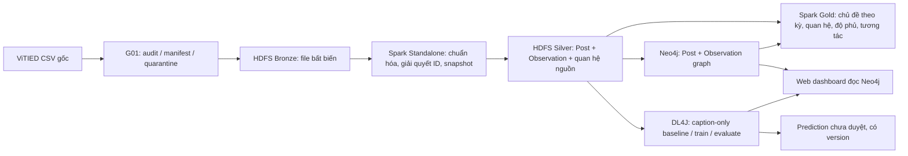

# Phân tích xu hướng chủ đề trên mạng xã hội — ViTIED

Project dùng **ViTIED** làm nguồn dữ liệu chính để nghiên cứu nội dung TikTok Việt Nam: nhóm/chủ đề nào xuất hiện trong mẫu, thay đổi theo **thời gian đăng** ra sao, gắn với hashtag và âm thanh nào, và mức tương tác được quan sát thay đổi thế nào. Kết luận luôn giới hạn trong mẫu KOL/KOC được thu; không suy rộng thành xu hướng của toàn TikTok.

> **Trạng thái 16/10/2026:** G01–G04 ViTIED đã nghiệm thu; graph v2 có thêm 34.750 Observation. G05 đã train DL4J phân tán trên caption-only features, giữ nguyên split; nhãn Topic cấp Post vẫn chờ người duyệt. G06 Gold nằm trên HDFS. Web dashboard dùng Neo4j làm DB duy nhất; PostgreSQL G07 cũ đã dừng và không còn là nguồn dashboard.

Ngày 14/10/2026, dữ liệu, mã và output của nguồn trước đã được gỡ khỏi workspace, HDFS, Neo4j và PostgreSQL theo yêu cầu. Các dịch vụ/volume Docker dùng chung được giữ; `/trend/vitied` và bằng chứng G01–G03 còn nguyên. Bronze khớp SHA-256, Silver fsck khỏe và đối chiếu Post/Observation khớp G01/local. G04 graph, G06 Gold và G07 PostgreSQL hiện được ghi nhận theo từng báo cáo gate bên dưới.

## 1. Câu hỏi phân tích và phạm vi

1. **Nội dung:** số **bài đăng duy nhất** theo tuần/tháng đăng và loại `video/photo`, nhóm nội dung nguồn, hashtag và âm thanh; nêu độ phủ quan sát theo kỳ.
2. **Quan hệ:** Post–Hashtag–Sound từ trường nguồn; nối Topic khi một chủ đề **ở cấp bài đăng** đã được rà soát. Đo hashtag/sound thường đi cùng chủ đề có support bằng số bài duy nhất.
3. **Tương tác:** tại mỗi `observed_at`, trình bày snapshot view/like/comment/share/save. Chỉ tính delta/tốc độ khi cùng bài có ít nhất hai snapshot nguồn hợp lệ. So sánh chủ đề theo tương tác phải nêu thời điểm và tuổi bài.
4. **ML bằng DL4J:** G05 đã học embedding 64 chiều chỉ từ caption bằng autoencoder trên hai worker với đồng bộ trọng số, rồi xuất cụm và mẫu để rà soát. Cụm chưa phải Topic. Supervised FNN/MLP phân loại Topic chỉ bắt đầu sau khi có nhãn bài đăng được rà soát. Dự đoán chưa duyệt ở bảng riêng.

`topic` trong ViTIED có dạng danh sách, đôi khi nhiều giá trị và khác chữ hoa/thường. Audit cả hai CSV cho thấy **mọi username có `topic` không rỗng đều chỉ có một giá trị cố định xuyên suốt các bài trong từng file** (0/371 author ở training và 0/347 ở streaming đổi giá trị). Vì thế project coi trường này là **`creator_category`/lĩnh vực KOL**, không phải nhãn Topic của bài đăng. Sáu nhóm rộng Beauty, Fashion, Food, Tech & Household, Health, Mom & Baby dùng để phân tầng mẫu, không tự nối `HAS_TOPIC`.

**Không nằm trong kết luận batch đầu:** dự báo xu hướng toàn nền tảng, tốc độ lan truyền, hiệu quả chiến dịch, âm thanh được nghe thực tế, hoặc lượt tương tác phát sinh trong tuần đăng chỉ từ một snapshot. Phân tích tăng trưởng tương tác và replay là nhánh riêng sau khi hợp đồng snapshot đạt gate.

Nguồn: [ViTIED repository](https://github.com/dthn-anna/ViTIED), [bài báo RIVF/IEEE](https://doi.org/10.1109/RIVF68649.2025.11365168). Repository nói hơn 35.000 video/record, abstract bài báo nói gần 14.000 video; **số bài duy nhất và snapshot được đếm từ hai CSV hoàn chỉnh**, không dùng một trong hai con số như baseline hardcode. README nguồn mô tả sử dụng học thuật nhưng repository hiện không thấy file LICENSE; kiểm tra quyền tái phân phối trước khi đưa CSV nguồn vào bản nộp công khai.

## 2. Nguồn dữ liệu và kết quả kiểm kê đầu tiên

Hai file nguồn dự kiến là `Dataset/training_data.csv` và `Dataset/streaming_data.csv`. Lưu bản byte gốc tại `data/raw/vitied/` (được Git ignore), ghi URL, commit nguồn, SHA-256, kích thước và thời điểm tải vào manifest. Không sửa CSV raw. `training_data.csv` có thêm cột đã xử lý sẵn như `vid_desc_clean`, `vid_hashtags_normalized`, `vid_existtime_hrs`; phải kiểm tra cách tạo và thời điểm có sẵn của chúng trước khi dùng làm feature.

`python scripts/audit_vitied.py` chỉ đọc raw và ghi [báo cáo nguồn](outputs/quality/vitied_source_audit.json). `python scripts/intake_vitied.py` kiểm tra SHA-256 theo [manifest](data/raw/manifests/vitied_source_20261013.json), schema từng file, URL, thời gian, taxonomy nguồn, trùng/xung đột và xuất [báo cáo G01](outputs/quality/vitied_g01.json), [bảng giải quyết ID](outputs/quality/vitied_id_resolution.csv), [pointer quarantine](data/quarantine/vitied_g01_pointers.csv). Hai lệnh đều giữ nguyên raw. **G01 trên bản nguồn hiện tại:** 34.750 snapshot từ 9.114 bài duy nhất, gồm **8.731 video và 383 bài ảnh**, 384 username. Mỗi bài có ID URL TikTok hợp lệ, ánh xạ raw ID ↔ URL ID một-một, loại bài và tác giả nhất quán; không có dòng quarantine hay cặp bài–thời điểm quan sát bị trùng/xung đột. Đây là kiểm tra tính nhất quán của nguồn, không chứng thực URL còn hoạt động ngoài mạng.

Toàn bộ **5.114 dòng streaming** có `vid_id` lệch ID trong URL 257–312 đơn vị, phù hợp dấu hiệu làm tròn số khi export; canonical `post_id` lấy từ đoạn `/video/<id>` hoặc `/photo/<id>` trong URL TikTok hợp lệ, giữ `raw_vid_id` và trạng thái giải quyết. `music_id` phần lớn ở ký pháp khoa học nên không phục hồi bằng số dấu phẩy động. Có **1.829 bài** mà các snapshot khác giây đăng nhưng vẫn cùng phút; giữ timestamp gốc trên từng snapshot, dùng `published_minute_utc` cho grain bài/biểu đồ thời gian. `vid_nshare='Share'` xuất hiện **848 dòng** và phải được coi là thiếu, không phải 0. `topic` nguồn thiếu/unknown 520 dòng; không gán nhãn Topic cho bài từ giá trị này.

| Trường nguồn đã thấy | Vai trò dự kiến | Quy tắc |
|---|---|---|
| `vid_id`, `vid_url` | Khóa/đối chiếu bài | Đọc chuỗi nguyên văn; lấy canonical ID và `media_type=video/photo` từ URL TikTok hợp lệ khi ánh xạ một-một; giữ raw ID và `id_resolution_status`. Không sửa ID bằng ép kiểu. |
| `user_name` | Metadata tác giả | Namespace username; không coi là author ID xác minh. |
| `vid_postTime` | Thời điểm đăng | Parse offset nguồn, lưu UTC trên snapshot; bài dùng phút đăng canonical vì có xung đột giây trong cùng phút. Calendar dùng `Asia/Ho_Chi_Minh`. |
| `vid_scrapeTime` | Thời điểm quan sát | Parse offset nguồn, lưu UTC; không lấy thời điểm import làm lịch sử nguồn. |
| `vid_caption`, `vid_hashtags` | Nội dung | Giữ null khác rỗng; normalize Unicode/hashtag có version. |
| `music_id`, `music_title`, `music_authorName` | Sound | Không khôi phục ID chính xác từ ký pháp khoa học hoặc gộp theo tên; đánh dấu unresolved. |
| `topic` | `creator_category` nguồn | Parse danh sách an toàn, chuẩn hóa case theo mapping G01 `vitied-g01-v1`; `[]`, `[nan]`, null là unknown. Không dùng làm ground truth Topic bài. |
| `vid_nview`, `vid_nlike`, `vid_ncomment`, `vid_nshare`, `vid_nsave` | Snapshot tương tác | Parse hậu tố K/M và null có kiểm tra; `Share` là missing, không phải 0; không dùng snapshot tương lai làm feature. |

`Effect` và `Location` không thấy trong schema CSV ViTIED đã kiểm kê; pipeline ViTIED không tự tạo hai node hoặc quan hệ này. Các cột `vid_duration`, `user_nfollower`, `user_total_likes`, `music_nused` cũng có thể đổi theo snapshot; giữ ở grain quan sát khi cần.

## 3. Kiến trúc đích và phần Docker được tái sử dụng

Tra cứu bảng công nghệ theo công đoạn, trạng thái runtime hiện tại và lệnh xem log tại [docs/architecture-and-logs.md](docs/architecture-and-logs.md).



Giữ [Compose hiện có](infra/compose.yaml): Hadoop 3.4.2, **1 NameNode + 3 DataNode**, replication 2, volume NameNode và từng DataNode riêng; Spark 4.0.2 **1 Master + 2 Worker + driver**; Neo4j 5.26 Community. Web stack chỉ bật Neo4j và dashboard; PostgreSQL/Power BI overlay cũ không nằm trong lệnh khởi chạy web. Cấu hình máy đặt **1 core và 768 MiB Spark executor/worker**, container worker giới hạn 1.280 MiB; driver 1.280 MiB. `infra/compose.dl4j.yaml` cung cấp Maven/JDK 17; G05 chạy hai JVM DL4J trong container worker và coordinator ở driver, **không phải Spark executor task train**. Đây là cụm container trên **một host**, không có HA host.

[G02 ViTIED](GD2.md) đã kiểm tra SHA-256 HDFS, fsck replica/location, task Spark trên hai worker và restart giữ dữ liệu. [G03 ViTIED](GD3.md) đã nạp Bronze bất biến và xuất Silver `vitied-silver-v3` sau đối soát. Spark CSV reader thử nghiệm từng hụt 3 dòng training; job G03 đọc byte CSV bằng Python `csv.DictReader` trong tác vụ Spark và khớp đủ 29.636 dòng training. Không format NameNode hay xóa volume khi đổi dataset.

| Tầng | Đường dẫn/hợp đồng đích | Trạng thái |
|---|---|---|
| Raw Windows | `data/raw/vitied/*.csv` bất biến + manifest | G01 đã kiểm kê ID/schema và phân biệt video/photo; nhãn Topic cấp bài vẫn chưa có |
| HDFS Bronze | `/trend/vitied/bronze/vitied-20261013-370234d0358b/` | Đã upload hai CSV, đọc lại SHA-256 khớp manifest; không ghi đè khi chạy lại |
| HDFS Silver | `/trend/vitied/silver/vitied-silver-v3/vitied-20261013-370234d0358b/` gồm `posts`, `observations`, `creator_categories`, `post_hashtags`, `quarantine` | Đã xuất bằng Spark hai worker, read-back và so khóa với G01/local; 9.114 Post, 34.750 Observation. `v1/v2` là lần chạy thử, `v3` là bản active. |
| HDFS Gold | `/trend/vitied/gold/<publication_id>/post_period`, `topic_period`, `hashtag_period`, `hashtag_pair_period`, `topic_hashtag`, `topic_sound`, `engagement_observation`, `coverage` | [G06 publication](GD6.md) đã nghiệm thu: 9.114 Post, 34.750 snapshot; read-back khớp. `topic_*` rỗng có schema rõ ràng cho đến khi có nhãn Post được duyệt/Sound ID xác thực. |
| Neo4j | Graph serving duy nhất: 9.114 Post, 34.750 Observation, 10.549 Hashtag, 40.624 `HAS_HASHTAG`, 34.750 `HAS_OBSERVATION`; mọi query lọc dataset | [G04 graph v2](outputs/quality/g04_graph_load.json) checksum, reload/idempotency và counts đạt; web dashboard đọc trực tiếp. Sound/Topic bằng 0 theo giới hạn nguồn/nhãn. |
| PostgreSQL | Release G07 lịch sử, không dùng bởi web hiện hành | Publication cũ được giữ làm bằng chứng; service đã dừng, volume không bị xóa. |

## 4. Hợp đồng grain, nhãn và đồ thị

- **Post:** một canonical `post_id` lấy từ URL TikTok đã kiểm tra; `media_type` là `video` hoặc `photo`. Record chưa giải quyết ID ở quarantine có source pointer; không tạo node từ ID làm tròn hoặc nhập nhằng. Giữ `raw_vid_id`, `url_media_id`, `source_file`, `source_row`, `dataset_version` để đối soát. Bảng [ID G01](outputs/quality/vitied_id_resolution.csv) là một dòng/bài.
- **Observation:** một Post × `observed_at_utc`; giữ timestamp đăng gốc theo dòng. G01 không phát hiện trùng/xung đột trên bản nguồn hiện tại; adapter G03 vẫn phải kiểm tra lại khi dữ liệu thay đổi. Graph v2 có node `Observation` và cạnh `HAS_OBSERVATION` để dashboard đọc snapshot từ cùng DB.
- **Creator category và Post Topic:** `topic` CSV giữ dưới tên `creator_category` có provenance nguồn; một tác giả có thể thuộc nhiều category. `reviewed_topic` là nhãn nội dung **từng bài** từ quy trình rà soát riêng. Cluster từ embedding DL4J chỉ là ứng viên chủ đề, không là ground truth. Dự đoán DL4J có modelVersion/threshold/status=`provisional`, không ghi đè manual; nhãn chưa rà soát là unknown.
- **Graph ViTIED:** các label mục tiêu `Post`, `Sound`, `Hashtag`, `Topic`. G04 nạp `USES_SOUND`, `HAS_HASHTAG` khi nguồn có ID tương ứng; `HAS_TOPIC` chỉ khi có nhãn bài rà soát hoặc prediction provisional được công bố riêng. `creator_category` là metadata, không tạo Topic edge. Không dùng `Effect`/`Location` nếu CSV không có trường. Sound chỉ MERGE theo ID đã xác thực; ID unresolved giữ ngoài graph. Cạnh tổng hợp Hashtag–Hashtag và Sound–Hashtag có thể làm trước; Sound–Topic, Hashtag–Topic, Topic–Topic đợi Topic có bằng chứng. `postCount` là `COUNT DISTINCT post_id` trong cửa sổ đăng nửa mở theo `Asia/Ho_Chi_Minh`, kèm dataset/label/aggregation version.
- **Cách đọc xu hướng:** đếm bài theo thời gian **đăng**; view/like là snapshot ở thời gian **quan sát**. Tốc độ tăng dùng cặp snapshot cùng bài và nêu khoảng thời gian; delta âm được báo lỗi/điều chỉnh nguồn, không xóa dấu. Tuần không được quan sát là null, không điền 0. Chỉ so sánh Topic theo tỷ lệ trong **mẫu được quan sát** và kèm support/độ phủ.

## 5. DL4J và đánh giá

Bản hiện hành theo mục tiêu chủ đề: train-only TF-IDF/SVD baseline và **autoencoder DL4J 64 chiều caption-only** → vector Post → cụm khám phá. Đầu vào một Post: chọn Observation sớm nhất theo `observed_at_utc`, source pointer làm tie-break; hashtag được loại khỏi feature và không union qua snapshot. 781 bài thiếu caption ở Observation đầu và 79 bài vector rỗng được abstain; mẫu thiếu văn bản không nhân snapshot thành mẫu train. Nội dung snapshot đầu chỉ phản ánh lúc quan sát, chưa chứng minh đúng nội dung ngay lúc đăng. Không dùng `creator_category` làm nhãn bài. Khi có tập bài được rà soát đủ support, thử **FNN/MLP DL4J nhiều nhãn** so với baseline đơn giản; trong lúc đó, dashboard dùng caption phrases, cohort cụm và tương tác làm gợi ý rà soát.

[G05 đã chạy](GD5.md) với feature active `vitied-g05-caption-idf512-v1`: 9.114 Post split theo 384 tác giả và caption trùng; 860 abstain; 5.947/1.023/1.284 vector train/validation/test. DL4J `captiononly-ae64` có test MSE 0,001655 so với SVD 0,001321; ARI giữa seed 0,982 so với 0,753; silhouette validation 0,078 so với 0,060. Phiếu 80 Post chưa được duyệt, nên G05 chưa xuất Topic và không đưa cluster vào Neo4j/Gold như nhãn thật.

Yêu cầu huấn luyện phân tán G05: sau khi cố định split và feature chỉ fit trên train, xuất shard train có manifest từ Silver HDFS sang workspace chung cho JVM; hai worker **đều chạy bước cập nhật trọng số DL4J**, coordinator đồng bộ cập nhật có trọng số theo số mẫu và lưu checkpoint/seed/version. Spark chỉ chuẩn bị/chia dữ liệu thì chưa đạt gate. Không dựa vào `dl4j-spark` cũ với Spark 4; điều phối JVM DL4J trên hai container worker, phân biệt rõ với tác vụ do Spark scheduler chạy. ND4J CPU smoke và hai JVM 512 MiB heap đã chạy trong giới hạn container worker 1.280 MiB; giới hạn Spark executor 768 MiB không phải tài nguyên train Java này. Khi chạy lệnh train, stdout/stderr của từng JVM được stream trực tiếp ra terminal với nhãn worker và lưu thành `.console.txt`; xem hướng dẫn [log và lệnh chạy](GD5.md#xem-log-train-để-demo). Báo log worker/round/sample, loss train/validation, save/load, so sánh 1 và 2 worker cùng dữ liệu/lượt học, thời gian và tài nguyên đo thực. Bộ dữ liệu nhỏ hiện chạy hai worker chậm hơn một worker.

Split theo **Post và author** trước khi fit tokenizer/vocabulary/scaler; mọi snapshot cùng bài ở một split. Có đánh giá theo thời gian riêng khi dự đoán tương lai. Với cụm chưa giám sát: báo support, ổn định qua seed và tỷ lệ mẫu được người duyệt thấy nhất quán; không gọi cluster ID là Topic đã xác nhận. Với classifier có nhãn rà soát: baseline, Micro/Macro-F1, precision/recall/F1 và support từng Topic, coverage/abstention; threshold chọn trên validation. Lưu model, taxonomy/label order, seed, split manifest, feature version, save/load round-trip. Không chọn model bằng test.

Nhánh tùy chọn sau batch: dự đoán **delta tương tác** từ snapshot đầu sang snapshot sau bằng DL4J, so với baseline giữ nguyên/median. Feature chỉ từ thời điểm đầu; target dùng observation nguồn về sau. Báo MAE và metrics theo mức tăng cùng horizon/coverage. Đây là câu hỏi khác với phân loại Topic và không thay đầu ra chủ đề chính. ViTIED là dữ liệu lịch sử; replay qua NiFi/Kafka không biến nó thành crawl realtime.

## 6. Web dashboard và nghiệm thu kết quả

Dashboard đọc trực tiếp Neo4j; không cần PostgreSQL trung gian. Giao diện khách hàng có sidebar sáu mục báo cáo riêng: Tổng quan, Nhịp tăng/giảm, Kịch bản 4 tuần, Phản hồi nội dung, So sánh nhóm và Mạng lưới quan hệ. Mỗi mục mở một màn phân tích riêng. Nội dung tập trung vào thay đổi tỷ trọng nhóm caption trong 4 tuần, độ lan rộng qua creator, kịch bản tỷ trọng 4 tuần và tỷ lệ like/view quan sát giữa nhóm. Không hiển thị bộ lọc video/ảnh, ID bài, top bài hay thông số DL4J; tên nhóm là gợi ý đọc nhanh, chưa phải Topic được duyệt. Backend chọn baseline giữ nguyên tỷ trọng vì backtest cuốn chiếu cho sai số thấp hơn ngoại suy xu hướng. Đây là tỷ trọng trong mẫu ViTIED, không đại diện cho toàn TikTok. Nguồn kết thúc 02/07/2025; phép chiếu hiện tại là hồi cứu, không dự báo TikTok hiện nay. Ngoại suy xu hướng có MAE 3,06 điểm % so với baseline 2,91 điểm % trên 7 cửa sổ, nên dashboard chọn baseline. Backtest chỉ có tính thăm dò do cụm G05 được học trên split tác giả trải khắp thời gian, không phải kiểm định out-of-time nghiêm ngặt. Cụm DL4J chưa được người duyệt gán nhãn Topic. Báo cáo mạng gom toàn bộ hashtag trong kỳ thành graph đồng xuất hiện từ quan hệ Post–Hashtag. Cạnh cần tối thiểu 3 bài và 2 creator, trọng số PPMI có hiệu chỉnh IDF; hashtag phủ trên 5% bài vẫn được đếm nhưng không tham gia link scoring để tag phổ thông như #xuhuong không lấn điểm. ArticleRank xếp vai trò trung tâm; Closeness Centrality xếp hashtag theo khoảng cách có trọng số tới các node khác trong mạng.

Chạy dashboard cục bộ:

```powershell
docker compose -f infra/compose.yaml --profile graph -f infra/compose.web.yaml up -d --build neo4j web-dashboard
```

Mở `http://localhost:8787`. Ứng dụng dùng credential Neo4j qua secret, chỉ phát truy vấn đọc và bind cổng loopback; không khởi chạy Spark/training khi tải/làm mới. Neo4j Community không hỗ trợ role chỉ đọc nên credential đó vẫn có quyền admin; không đưa cổng dashboard ra mạng tin cậy rộng. Caption-only model analysis được mount read-only. Kiểm tra bằng `python scripts/verify_g07_web_dashboard.py`; xem [báo cáo G07](GD7.md).

### G06 Gold batch

`jobs/spark/06_vitied_gold.py` tạo publication bất biến từ đúng Silver/G03 đã kiểm chứng và G04 manifest khớp dataset version. Job xuất `post_period` theo ngày đăng Việt Nam và media type; `hashtag_period` và `hashtag_pair_period` dùng hashtag ở Observation sớm nhất của mỗi Post; `engagement_observation` giữ grain Post × `observed_at_utc`; `coverage` báo độ phủ nội dung/metric và số snapshot. Job đối soát chính xác tập Post ID và cạnh Post–Hashtag của graph export với Silver. `topic_period`, `topic_hashtag`, `topic_sound` được xuất với schema nhưng không có dòng cho tới khi có nhãn Post được duyệt hoặc Sound ID được xác thực. Creator category và cluster G05 không được biến thành Topic.

Chạy khi Docker Compose HDFS/Spark đang hoạt động:

```powershell
docker compose -f infra/compose.yaml exec -T spark-driver /opt/spark/bin/spark-submit --master spark://spark-master:7077 --deploy-mode client jobs/spark/06_vitied_gold.py --silver /trend/vitied/silver/vitied-silver-v3/vitied-20261013-370234d0358b --publication-id vitied-gold-v1-20261014
```

Job từ chối ghi đè publication, kiểm tra G03/G04 provenance, ghi staging HDFS, đọc Parquet lại, đối soát Post/Observation/Hashtag và yêu cầu task witness trên cả hai Spark worker trước khi atomic rename. Publication hiện tại `vitied-gold-v1-20261014` đã chạy đạt; xem số đếm và giới hạn ở [GD6](GD6.md). Mỗi lần chạy tiếp theo cần `publication_id` mới để giữ release bất biến.

### G07 Graph-backed web dashboard

G06 Gold vẫn ở HDFS. PostgreSQL publication/DDL/loader ở phần G07 trước là triển khai lịch sử và đã dừng; web hiện tại đọc trực tiếp Neo4j qua account secret. G04 graph v2 nạp Observation cùng snapshot metrics, nên không cần duplicate các bảng Gold sang database thứ hai chỉ để vẽ UI. Power BI design pack cũ không còn là dashboard giao hàng.

Kiểm chứng graph-backed dashboard: [38 API/data và UI checks](outputs/quality/g07_web_dashboard.json), gồm tổng share forecast = 100%, 7 cửa sổ backtest và xác nhận phương pháp được hiển thị là phương pháp có lỗi thấp hơn. Không dùng cluster DL4J làm Topic; dashboard báo chưa có nhãn Post được duyệt.

## 7. G01–G09 sau khi đổi nguồn

| Giai đoạn | Việc cần làm | Gate nghiệm thu ViTIED |
|---|---|---|
| G01 | Kiểm kê hai CSV, checksum, schema, canonical Post/author/snapshot, creator category, ID/time conflict | [Báo cáo nghiệm thu](GD1.md), bảng ID, quarantine pointer, đối soát 34.750 = 34.750 accepted + 0 quarantine; **done trên source version hiện tại** |
| G02 | Tái dùng Compose HDFS/Spark, mount/readback ViTIED | [Báo cáo nghiệm thu](GD2.md): 3 DataNode, replica 2, SHA-256 đọc lại sau restart và task trên cả hai worker; **done**. Parser CSV Spark lệch 3 dòng training, chuyển sang G03. |
| G03 | Upload Bronze, Spark normalize CSV → Silver Post/Observation/relations | [Báo cáo nghiệm thu](GD3.md): 34.750 raw = 34.750 accepted + 0 duplicate/conflict/quarantine; Post/Observation khớp G01/local, task trên hai worker, HDFS fsck khỏe; **done trên source version hiện tại** |
| G04 | Graph ViTIED nodes/relationships có bằng chứng, constraints, loader, projection | [Báo cáo nghiệm thu](GD4.md): graph v2 có 9.114 Post và 34.750 Observation; reload giữ count; **done trên source version hiện tại**. Sound/Topic đợi ID/nhãn hợp lệ. |
| G05 | Autoencoder DL4J 64 chiều huấn luyện trên hai worker, cụm nội dung và rà soát bài; classifier khi có nhãn | [Báo cáo G05](GD5.md): split và checkpoint, cập nhật trên cả hai worker, baseline/metrics/benchmark, mẫu rà soát; **in_progress**, đợi nhãn người duyệt và chưa có classifier Topic. |
| G06 | Aggregate theo kỳ, Gold, đối soát đồ thị/nhãn | Distinct Post, cửa sổ/version/support, không trộn source category với manual/prediction; **chưa bắt đầu** |
| G07 | Web dashboard đọc Neo4j trực tiếp | Neo4j, dashboard sidebar sáu mục và các trang phân tích riêng đã rebuild; **in_progress**, còn chờ xem trực quan trên desktop/màn hẹp |
| G08 | NiFi/Kafka replay CSV lịch sử sau batch | Timestamp nguồn, offset/checkpoint, idempotent sink/restart và nhánh lỗi; **chưa bắt đầu, tùy phạm vi** |
| G09 | End-to-end, failure demo trên cụm thử, benchmark, tài liệu | Bằng chứng từng tầng và so sánh 1/2 worker có output tương đương; **chưa bắt đầu** |

M1 = G01–G03 **đạt gate trên source version hiện tại**. M2 = G04–G07; G04/G06 đã đạt cho dữ liệu có bằng chứng, G05 vẫn chờ duyệt nhãn và G07 chờ kiểm tra dashboard web trực quan trên desktop/màn hẹp. Bước tiếp theo là review giao diện/filter G07 và rà soát [phiếu G05](data/labels/vitied_g05_review_mixed.csv) trước khi đưa Topic lên dashboard. M3 = G08–G09 nếu chọn streaming. Theo dõi bằng chứng ở [reports/progress.md](reports/progress.md).

### Chạy lại G03 cho source version hiện tại

1. `python scripts/upload_vitied_bronze.py` kiểm tra SHA-256 từ manifest, nạp HDFS nếu chưa có và xác minh byte đọc lại. Bronze cùng version có sẵn chỉ được xác minh, không ghi đè.
2. Với Docker Compose đang chạy, dùng `docker compose -f infra/compose.yaml exec -T spark-driver /opt/spark/bin/spark-submit --master spark://spark-master:7077 --deploy-mode client jobs/spark/03_vitied_silver.py --bronze /trend/vitied/bronze/vitied-20261013-370234d0358b --silver /trend/vitied/silver/vitied-silver-v3/<run_id_moi>`; output đã tồn tại sẽ báo lỗi để tránh ghi đè. Tên run mới chỉ dùng khi chủ ý tạo bản Silver mới từ cùng nguồn.
3. `python scripts/build_g03_expected.py` tạo khóa Observation độc lập bằng stdlib CSV; chạy `jobs/spark/03_verify_vitied_silver.py --silver <path>` qua `spark-submit` để đối chiếu Post/Observation. `python scripts/verify_g03_hdfs.py` kiểm tra đường dẫn release active ghi trong script; đổi đường dẫn khi phát hành bản mới.

Hợp đồng Silver: `posts` một dòng/Post canonical; `observations` một dòng/Post × `observed_at_utc` với raw ID, raw Share, timestamp đăng nguồn và snapshot tương tác; `post_hashtags` một dòng/Post × `tag_key` (NFC, bỏ `#`, casefold); `creator_categories` một dòng/username × category nguồn. Timestamp là UTC, lịch phân tích dùng `Asia/Ho_Chi_Minh`. Giá trị nguồn rỗng/`Share` là null, không ép thành 0. `sound_id` chỉ có khi `music_id` là chuỗi ID nguyên 18–20 chữ số; ở source version này toàn bộ 34.750 observation đang unresolved, nên G04 không được tạo cạnh Sound từ ID suy đoán. `topic` nguồn vẫn là creator category, không phải nhãn bài. Chi tiết count, kiểm tra và giới hạn ở [GD3.md](GD3.md).
